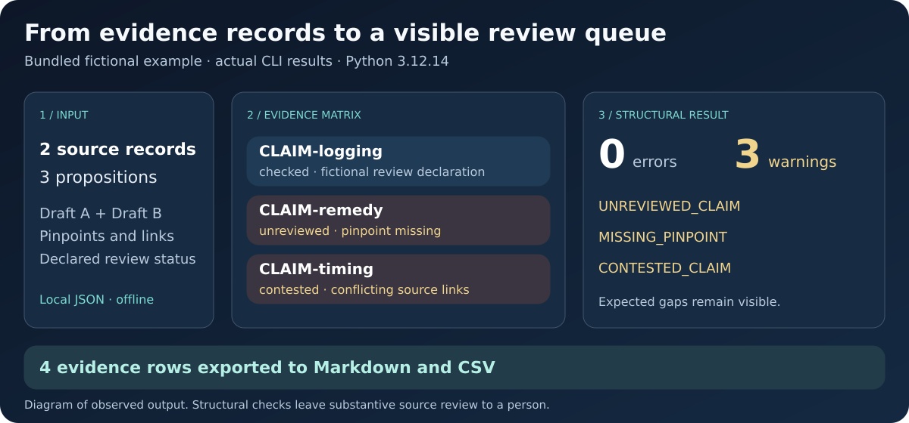

# RegNav: sustainability evidence and regulatory review

**Read reports. Trace the evidence. Inspect the basis for a decision.**

RegNav, short for Regulatory Navigator, brings document extraction, source
tracing, emissions calculations and structured evidence review into a local
Python workflow. It helps researchers and reporting teams move from a passage
in a sustainability report to an inspectable record of its source, assumptions,
qualifications and review status.

This repository contains the **ESG workbench** and **evidence ledger**. A separate
**private research extension**, described below, adds checks for comparability,
restatements, assurance scope, commitments and legal applicability.

Developed by **Albert Tan** · [Website](https://www.alberttansinhon.com/)
· [Research profile](https://research.rug.nl/en/persons/tan-sin-hon-albert-tan/)
· [ORCID](https://orcid.org/0009-0001-8996-7933)

**Status:** working research prototype, version 0.1. The public workflow runs
locally; model assistance is an explicit opt-in. Outputs remain candidates for
human review. See [validation and scope](#validation-and-scope) and
[rights and citation](#rights-and-citation).

[Capabilities](#what-you-can-do-in-this-repository) ·
[Fictional example](#see-the-evidence-in-a-fictional-report) ·
[Run the demo](#run-the-public-demo) ·
[Private extension](#private-research-extension) ·
[Full workbench guide](docs/ESG_WORKBENCH.md)

## See it in action



Supply the bundled [fictional ledger](examples/synthetic_ledger.json): three
propositions, two source records and four evidence links. The observed run
returned **0 structural errors and 3 expected warnings**: an unreviewed
proposition, a missing pinpoint and a contested proposition.

From the repository folder, with Python 3.10 or newer:

```bash
python -m regnav_evidence validate examples/synthetic_ledger.json
python -m regnav_evidence report examples/synthetic_ledger.json --format markdown
```

[Inspect the resulting matrix](docs/sample_report.md) ·
[Read the captured command output](docs/demo/observed-session.txt) ·
[Follow the ten-minute guide](docs/quickstart.md)

The diagram reflects the actual synthetic run. Source interpretation and
substantive review remain with a person; existing [reuse rights](RIGHTS.md) apply.

## What you can do in this repository

| Task | Working capability | What you can inspect |
| --- | --- | --- |
| **Read sustainability reports** | Ingest PDF, text and Markdown; optionally extract tables or run local English OCR | Retained page text, physical PDF page numbers, parser details and explicit incomplete-extraction states |
| **Find relevant disclosures** | Search local pages, extract configurable disclosure candidates and produce extractive summaries | Exact passages, field matches, surrounding context and disclosed candidate limits |
| **Trace a figure to its source** | Retain document and page-text hashes, quotations and character offsets; check anchors before export | The source passage behind each candidate and whether its retained location matches |
| **Use model-assisted extraction** | An opt-in adapter retrieves selected pages, requests structured model output and checks quotations and literal fields | Model/prompt records, selected context and rejected unsupported quotations or literal values; live evaluation remains pending |
| **Calculate emissions inventories** | Import CSV/TSV or supported XLSX data; calculate with supplied, versioned factors and compatible units | Activity and factor records, inventory totals, facility totals grouped by entity and separate scope and Scope 2 accounting categories |
| **Screen materiality and locate standards references** | Screen financial and impact perspectives separately; resolve exact framework/version/code combinations in supplied records | Explicit rubrics, scores, reasons, evidence, thresholds and source-reference records |
| **Prepare accountable actions** | Turn supplied gaps and templates into proposed actions | Owners, deadlines, success criteria, optional budget ranges and missing inputs |
| **Review and share the evidence** | Generate an offline HTML view, JSON, CSV, Markdown and compatible unreviewed ledger records | Candidate filters, links to retained source pages and a portable evidence record |
| **Identify records needing reconsideration** | Compare saved ledgers; use the separate Source Watch experiment for listed file-byte changes | Changed propositions, source records and evidence links; linked claims whose review may need attention |

The [workbench guide](docs/ESG_WORKBENCH.md) gives the contracts, commands and
practical limits. Defaults include ten illustrative extraction fields.
Materiality rubrics, emission factors and standards records must be supplied and
reviewed for the intended use. A located quotation establishes where text occurs;
it does not establish source truth or support for a proposed inference.

## See the evidence in a fictional report

The bundled [demo generator](examples/esg/make_demo.py) creates two original,
clearly fictional sustainability PDFs. The generated example contains **two
documents, five physical pages and 33 candidate passages**. These source passages
are retained by the document workflow:

| Fictional source | Physical PDF page | Retained passage |
| --- | --- | --- |
| 2024 report | 1 | Scope 1 emissions: 100 tCO2e. |
| 2025 report | 1 | Scope 1 emissions: 110 tCO2e. |
| 2025 report | 1 | The 2024 Scope 1 comparative is restated to 120 tCO2e. |
| 2025 report | 1 | Boundary: Facilities A and B. Method changed after adding Facility B. |
| 2025 report | 3 | Limited assurance covers Scope 1 emissions for Facility A only. |

The HTML report places disclosure candidates beside navigable retained source
pages. The extraction records preserve the source identity, exact quotation,
page and offsets. This makes the next review questions visible: which prior
figure is the justified comparator, did the boundary change, and what does the
assurance statement actually cover?

**Preview without running Python:** [download the generated HTML example](https://raw.githubusercontent.com/Albertito-AI/policykit/main/examples/esg/sample_report.html)
and open the saved file in a browser. GitHub's
[file view](examples/esg/sample_report.html) displays the HTML source; it is not
a hosted application. This sample demonstrates extraction and source navigation.
The calculation, screening and planning examples are separate commands below.

## Run the public demo

Use **Python 3.10 or newer**, from the root of a checkout you are permitted to
use under [RIGHTS.md](RIGHTS.md). Install the optional Python PDF parser first:

```bash
python -m pip install '.[pdf]'
```

Choose input and output directory names that do not already exist. The following
commands create the fictional PDFs, extract their disclosures, generate the
HTML workbench and validate the resulting evidence ledger:

```bash
python examples/esg/make_demo.py demo-input
python -m regnav_esg run demo-input/fictional_2024.pdf demo-input/fictional_2025.pdf --output demo-output --source-url https://example.org/fictional-2024 --source-url https://example.org/fictional-2025 --jurisdiction FICTIONAL
python -m regnav_evidence validate demo-output/ledger.json --json
```

**Open `demo-output/report.html` in your browser.** No API key is required for
this demonstration. Its example source URLs are fictional identifiers and are
never fetched. For real documents, supply the original source URLs; omitting
them produces the workbench without a ledger export. Generated claims remain
`unreviewed`, so review warnings are expected.

| Output | Purpose |
| --- | --- |
| `report.html` | Offline review view with candidate filters and source-page navigation |
| `documents.json` and `source-N.md` | Retained page text, parser details, hashes and page-labelled Markdown |
| `extractions.json` and `candidates.csv` | Candidate passages, field matches and locations |
| `assessments.json` | Results from explicitly supplied assessment inputs; none are inferred from the demo PDFs |
| `ledger.json` | Unreviewed evidence records when original source URLs are supplied |

### Try calculations, screening and planning

These commands use the supplied fictional examples. The factors, thresholds,
standards and budgets are demonstration inputs, not production defaults.

```bash
python -m regnav_esg import-activities examples/esg/activities.csv
python -m regnav_esg inventory examples/esg/inventory.json
python -m regnav_esg materiality examples/esg/materiality.json
python -m regnav_esg standard examples/esg/standards.json 'Fictional Disclosure Framework' 'v1' 'METRIC-01'
python -m regnav_esg plan examples/esg/plan.json
```

| Fictional fixture | Demonstrated output |
| --- | --- |
| Inventory | 250 kgCO2e Scope 1; 500 Scope 2 location-based; 200 Scope 2 market-based; 100 Scope 3. The 18 kg of biogenic CO2 remains separate. |
| Materiality | The water topic scores 1.25 financially and 4.75 for impact under the supplied threshold of 3: screened out financially and screened in for impact. |
| Action plan | One proposed action and one draft with missing fields; a supplied SGD 100–200 estimate is retained. |

For optional table and spreadsheet support, install `'.[pdf,tables,excel]'`.
OCR additionally requires local `pdftoppm` and Tesseract installations.
See the guide for [document commands](docs/ESG_WORKBENCH.md#individual-document-commands),
[model-assisted extraction](docs/ESG_WORKBENCH.md#optional-retrieval-and-model-extraction)
and [operational data](docs/ESG_WORKBENCH.md#operational-data-and-calculations).
The model adapter requires credentials, a chosen model and explicit network
opt-in; its protocol tests use mocked responses.

## Private research extension

**Availability: implemented in a separate private development package. Its code,
detailed contracts and private development materials are not included in this
repository or installed by the commands above.**

The extension operationalises distinctions from Albert Tan's research using
explicit evidence records. An adapter connects selected public-workbench
extraction candidates to private review inputs, preserving their source anchors.
Entity, boundary, methodology, period and other interpretive metadata must be
supplied explicitly and reviewed.

| Private capability | What the implementation checks |
| --- | --- |
| **Comparable annual figures and restatements** | Metric, unit, period, entity, boundary, methodology and factor information; retains original, restated and current figures and withholds incompatible comparisons |
| **Assurance scope** | Supplied coverage, reporting period, entity, boundary and assurance level; flags claims extending beyond the supplied statement |
| **Commitments and execution** | Prior plans against later supplied observations; distinguishes missing disclosure, reported completion/non-completion and supplied execution-evidence references |
| **Review dependencies** | Changed dependencies behind a recorded review declaration; identifies the need for reconsideration |
| **Local-duty applicability** | Supplied jurisdiction, dates, conditions and exemptions; keeps a framework reference distinct from the local source of a duty |
| **Claims and corrective actions** | Distinguishes reporting assertions, assurance, compliance, alleged breach and supplied corrective powers; returns unresolved review questions |

### Two demonstrated review outcomes

**Changed basis:** the private PDF-linked example selects the extracted 100 and
110 figures shown above. Operator-supplied metadata records the different
boundaries and methods, while factor versions remain unknown. The result is
`NOT_COMPARABLE`, with the percentage calculation withheld. The captured 120
restatement passage remains available for review; it is not silently substituted.

**Explicit restatement:** a separate fictional case supplies original prior
100, restated prior 120 and current 110 records on a declared comparable basis.
The extension retains all three and calculates approximately **−8.33%** against
the restated baseline. It reports the numerical direction without declaring
an environmental performance improvement.

These are internal engineering demonstrations. Private development results are
not independently reproducible from this public checkout. The extension does
not supply an exhaustive validated legal-rule corpus, an assurance opinion,
authenticated reviewer identity or a legal finding. Its description makes no
claim that competitors lack similar capabilities. For a bounded evaluation,
see [CONTRIBUTING.md](CONTRIBUTING.md) and [RIGHTS.md](RIGHTS.md).

## Validation and scope

| Evidence | What it establishes |
| --- | --- |
| **237 public tests passed locally** on Python 3.12.14, recorded 28 October 2026 | Regression behaviour, including the original 126 tests; see the [development record](docs/PROGRESS.md#local-esg-workbench-implementation) |
| **CI passed on Python 3.10, 3.12 and 3.14** for the reviewed workbench commit | The [recorded workflow](https://github.com/Albertito-AI/policykit/actions/runs/40655921222) includes optional parser installation, focused integration checks and the fictional PDF workflow |
| **A complete 217-page public report was ingested locally** | Execution of a real-PDF parser integration check; it is not an extraction accuracy benchmark |
| **Reproducible fictional examples** | Inspectable inputs and expected engineering behaviour; not evidence of customer adoption or professional validation |

The CI regression phase skips optional parser tests before dependencies are
installed. A later step exercises those parsers; system OCR and `pdftotext`
tests remain skipped on runners without their system dependencies. Test counts
are not independent accuracy measurements.

The next evaluation is a permitted report pair with independently checked
reference data, plus a live operator-configured model test. Measure page-anchor
accuracy, field coverage, table/OCR errors, abstentions and review effort.
See the [roadmap](docs/ROADMAP.md) and [current project status](docs/project_status.md).

The public workbench is a local, read-only review workflow. Authenticated
multiuser editing, a hosted service, a complete standards/factor corpus,
validated IFRS disclosure drafting and independently validated legal-rule packs
are not included. Independent professional accuracy, commercial-platform parity
and business outcomes remain unestablished.

## Use the evidence ledger directly

The core ledger works with supplied JSON records and has no third-party runtime
dependencies, API keys or network calls. The [ten-minute guide](docs/quickstart.md)
includes a paper route, troubleshooting and a [rendered sample report](docs/sample_report.md).

```bash
python -m regnav_evidence validate examples/synthetic_ledger.json
python -m regnav_evidence report examples/synthetic_ledger.json --format markdown
python -m regnav_evidence report examples/synthetic_ledger.json --format csv --output evidence.csv
python -m regnav_evidence init my-ledger.json --title "My research evidence register"
```

The synthetic ledger deliberately produces **three review warnings**. Its
sources and reviewers are fictional; the complete texts are in
[training_sources.md](examples/training_sources.md).

Record narrow propositions, exact source versions and reproducible pinpoints.
Classify evidence as `supports`, `qualifies`, `contradicts` or `context`.
A `checked` entry records a person's declared review; the software does not
authenticate that person or establish that a judgement occurred. Preserve
unresolved disagreement as `contested`. See the [schema](docs/schema.md) and
[review method](docs/review_method.md).

To identify changes after editing a saved ledger:

```bash
python -m regnav_evidence compare ledger-before.json ledger-after.json
python -m regnav_evidence compare ledger-before.json ledger-after.json --json
```

Both inputs must be structurally valid snapshots. The comparison distinguishes
substantive source, proposition and evidence-link changes from access-date and
review-declaration edits. It flags affected prior reviews for human
reconsideration without changing them. See the
[comparison instructions](docs/quickstart.md#after-editing-a-ledger-compare-saved-snapshots)
for exit codes and interpretation.

JSON retains the complete record. Exported CSV fields that could start formulas
are prefixed with an apostrophe; retain JSON for round trips. Outputs refuse
accidental overwriting as documented in the quickstart. The core ledger alone
does not retrieve sources, establish current law, validate court citation formats
or generate an OSCOLA bibliography.

## Research, teaching and integration

| Route | Start here |
| --- | --- |
| **Source-file change experiment** | [Source Watch](experiments/source_watch/README.md) checks explicitly listed local files against a baseline and returns linked claim IDs; inspect the [fictional result](experiments/source_watch/sample_report.json) |
| **Evidence handover experiment** | The [local adapter](experiments/evidence_handover/README.md) accepts one explicit JSON contract and retains supplied scope, process and review-history information |
| **Local agent integration** | The [MCP gateway](experiments/agent_gateway/README.md), [fictional exchange](experiments/agent_gateway/sample_exchange.json) and [capability catalogue](experiments/agent_gateway/services.json) document local stdio operation; see the [collaboration guide](docs/AGENT_NETWORK.md) |
| **Source-grounded legal case** | The [Singapore sustainability-reporting case](cases/singapore-sustainability-reporting/README.md) records two unreviewed propositions and five official source records, including a qualified Rule 703 cross-check; [case collection](cases/README.md) |
| **Teaching and usability** | A [55-minute fictional exercise](teaching/README.md), source packet and [external evaluation protocol](docs/evaluation_protocol.md); independent educational benefits remain unevaluated |

The legal case distinguishes source inspections on 23 and 26 October 2026 and
remains AI-prepared and **unreviewed**. Its later authority mapping is separately
documented. It does not assess an actual issuer, liability or remedies.

The research direction includes Tan's work on
[sustainability reporting in Singapore and Thailand](https://research.rug.nl/en/publications/converging-standards-divergent-accountability-sustainability-repo/)
and [sustainability disclosure in China](https://research.rug.nl/en/publications/when-does-a-sustainability-report-count-as-securities-disclosure-/).
These publications provide scholarly context; they do not evaluate or validate
this software.

For one recurring agent workflow, use the existing
[pilot invitation](https://github.com/Albertito-AI/policykit/issues/12).
Describe the client/version, non-confidential task and desired result. Keep
private documents, paths, credentials and billing details out of public comments.
An enquiry grants no additional permission; paid scope requires separately
agreed terms. There is no public execution endpoint or automated billing.

## Development

Read [CONTRIBUTING.md](CONTRIBUTING.md), the [workstream guide](docs/WORKSTREAMS.md)
and the [research standard](docs/RESEARCH_STANDARD.md). The
[release criteria](docs/release_readiness.md) distinguish implementation checks
from external evaluation and release decisions.

```bash
python -m unittest discover -s tests -v
```

Optional parser fixtures require the documented extras; install
`'.[pdf,tables,excel,test]'` when exercising those paths and inspect any skips.
Tests cover malformed input, source-anchor mismatches, calculation boundaries,
review metadata, export escaping, formula handling and file protection.

## Rights and citation

Use [CITATION.cff](CITATION.cff) to identify the software and cite the version
actually used. No DOI has yet been assigned. See [RIGHTS.md](RIGHTS.md) before
reuse: this public prototype is not currently supplied under an open-source
licence. Public visibility does not grant a commercial reuse licence or rights
to the separate private extension. Linked third-party material retains its own
rights status.

<details>
<summary>Earlier starter packages</summary>

The original [policykit-starter-v5.tar.gz](https://github.com/user-attachments/files/22344766/policykit-starter-v5.tar.gz)
and [policykit-extras-v1.zip](https://github.com/user-attachments/files/22344754/policykit-extras-v1.zip)
links are retained for continuity. These separate legacy archives were not
reviewed as part of this prototype and are not dependencies of the workbench
or evidence ledger.

</details>
